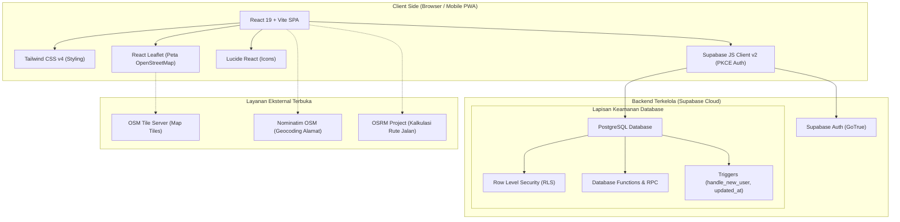
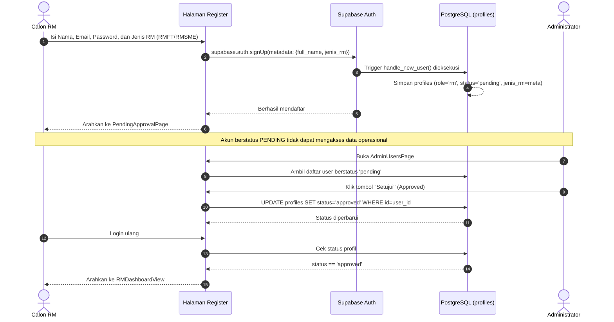
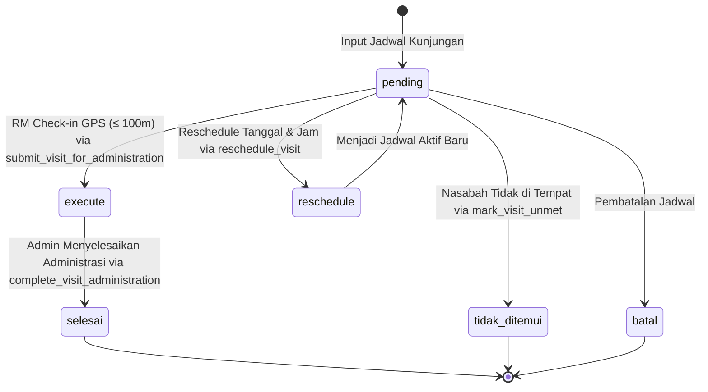
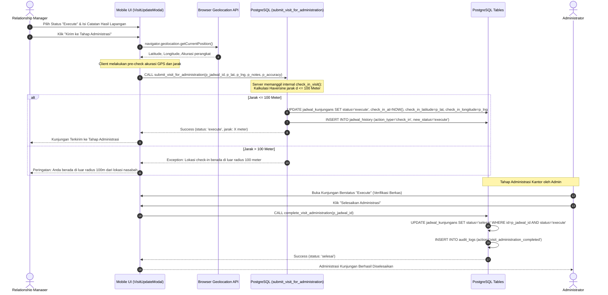
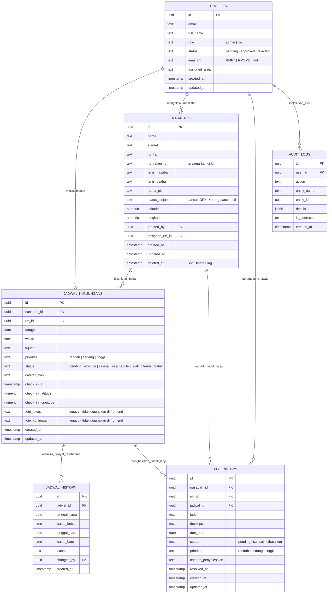

# Panduan Sistem e-VisitBRI
**Sistem Manajemen Kunjungan Relationship Manager Bank BRI KCP Iskandar Palembang**

---

> ## ⚠️ PETUNJUK UNTUK AI (MANDATORY INSTRUCTIONS FOR AI AGENTS)
>
> **Dokumen ini adalah sumber kebenaran tunggal (*single source of truth*) mengenai arsitektur, basis data, aturan bisnis, dan kondisi terkini aplikasi e-VisitBRI.**
>
> Setiap AI Agent atau pengembang yang berinteraksi dengan repositori ini **WAJIB** membaca dan mematuhi aturan berikut sebelum memberikan rekomendasi, menulis kode, atau menjalankan perintah:
>
> 1. **Dilarang Mengubah Aturan Bisnis Inti Tanpa Izin**:
>    - Role aplikasi **hanya dua**: `admin` dan `rm`. Jangan menambahkan role baru tanpa persetujuan eksplisit.
>    - Alur status registrasi adalah `pending` ➔ `approved` / `rejected`. Akun baru **tidak boleh** langsung aktif secara otomatis.
>    - **Alur Status Kunjungan**:
>      - RM melakukan check-in GPS lapangan berjarak maksimal **100 meter** dari koordinat nasabah melalui RPC `submit_visit_for_administration` (yang secara internal memvalidasi toleransi jarak melalui fungsi `check_in_visit`). Status kunjungan berpindah menjadi **`execute`** (tahap administrasi).
>      - Status **`selesai`** merupakan tahap akhir setelah proses administrasi dituntaskan oleh **Admin** melalui RPC `complete_visit_administration`. RM biasa **tidak dapat** langsung menandai jadwal menjadi `selesai`.
> 2. **Status Fitur Foto Bukti Kunjungan**:
>    - Fitur upload foto bukti kunjungan **sudah tidak digunakan pada frontend** (komponen upload dan berkas service storage telah dihilangkan dari antarmuka pengguna).
>    - Kolom `foto_lokasi` dan `foto_kunjungan` pada tabel `jadwal_kunjungans` serta bucket Supabase Storage `visit-evidence` merupakan peninggalan skema lama (*legacy schema*) dan tidak memiliki pemanggilan aktif di aplikasi. Jangan membuat kode baru atau dokumentasi yang mengesankan upload foto adalah fitur aktif.
> 3. **Dilarang Membocorkan atau Memasukkan Kredensial Rahasia**:
>    - Jangan pernah menuliskan `SUPABASE_SERVICE_ROLE_KEY`, password, token autentikasi, atau data nasabah riil ke dalam kode sumber, git commit, atau berkas `.env.example`.
>    - Frontend hanya boleh menggunakan `VITE_SUPABASE_URL` dan `VITE_SUPABASE_ANON_KEY` dengan otentikasi PKCE.
> 4. **Spesialisasi RM (`RMFT` vs `RMSME`)**:
>    - Kolom `jenis_rm` disimpan pada tabel `profiles` dengan nilai yang valid: `'RMFT'`, `'RMSME'`, atau `NULL` (khusus Admin).
>    - **Fakta Implementasi**: Pemisahan data nasabah saat ini berbasis **kepemilikan akun / assigned RM** dan basis nasabah bersama KCP Iskandar Palembang, **bukan** filter otomatis berbasis produk pinjaman/simpanan. Jangan mengarang bahwa ada filter otomatisasi produk jika belum diimplementasikan di SQL.
> 5. **Integritas Database dan Migrasi**:
>    - Jangan menghapus, memodifikasi, atau menjalankan ulang berkas migrasi yang sudah tercatat di Supabase Cloud.
>    - Penghapusan data nasabah menggunakan pendekatan **Soft Delete** (`deleted_at IS NOT NULL`). Jangan menggunakan `DELETE FROM nasabahs` secara permanen.
> 6. **Pengujian Regresi**:
>    - Setiap perubahan kode harus mempertahankan kelulusan pengujian otomatis (`npm test`), linter (`npm run lint`), dan kompilasi (`npm run build`).

---

## 1. Status Terkini Proyek

| Parameter | Kondisi Terkini |
|---|---|
| **Nama Aplikasi** | e-VisitBRI |
| **Status Deployment** | **Aktif Berjalan di Vercel Production** |
| **Domain Production** | [https://call-plan-bri.vercel.app](https://call-plan-bri.vercel.app) |
| **Unit Testing** | **85 test cases lulus (100%)** pada 16 test suites (`node --test`) |
| **Linting** | **0 error, 0 warning** (`eslint .`) |
| **Production Build** | **Berhasil dikompilasi** via Vite ke folder `dist/` |
| **Database & Auth** | Supabase PostgreSQL aktif, RLS aktif, RPC aktif, Migrasi `20261120000001` diterapkan |
| **Pemetaan Digital** | OpenStreetMap (OSM) gratis via Leaflet & React-Leaflet |
| **Desain Antarmuka** | Responsif Desktop (Sidebar lg+) & Mobile/Tablet (Bottom Nav RM & Admin, Kartu RM, Filter Peta) |

---

## 2. Identitas, Latar Belakang, dan Tujuan Sistem

### 2.1 Identitas Sistem
- **Nama Sistem**: e-VisitBRI
- **Pengguna Sasaran**: Relationship Manager (RM) dan Supervisor/Admin Bank BRI KCP Iskandar Palembang.
- **Fungsi Utama**: Perencanaan jadwal kunjungan (call plan), pemetaan lokasi sebaran nasabah, validasi kehadiran fisik berbasis GPS geofencing, pencatatan hasil kunjungan ke tahap administrasi (*execute*), penyelesaian administrasi oleh Admin (*selesai*), pemantauan tindak lanjut (*follow-up*), dan analitik kinerja RM secara real-time.

### 2.2 Latar Belakang dan Permasalahan
Aktivitas kunjungan nasabah oleh Relationship Manager merupakan pilar utama perbankan dalam menjaga kualitas portofolio kredit, menghimpun dana pihak ketiga (DPK), serta memitigasi risiko kredit bermasalah (NPL). Sebelum adanya e-VisitBRI, operasional KCP Iskandar Palembang menghadapi kendala:
1. **Pencatatan Terfragmentasi**: Perencanaan kunjungan menggunakan media terpisah (catatan kertas, aplikasi pesan instan, atau spreadsheet lokal) yang rentan hilang dan sulit direkonsiliasi.
2. **Ketiadaan Validasi Kehadiran Fisik**: Pimpinan/Admin sulit memverifikasi apakah RM benar-benar mendatangi lokasi nasabah atau melakukan kunjungan fiktif.
3. **Konflik Penjadwalan**: Terjadinya benturan jadwal kunjungan (*schedule collision*) pada jam yang sama oleh RM yang bersangkutan.
4. **Pemisahan Tahap Lapangan dan Administrasi yang Tidak Jelas**: Tidak adanya pemisahan antara selesainya kunjungan fisik di lapangan dengan tuntasnya kelengkapan berkas administrasi kantor.
5. **Follow-up yang Terabaikan**: Komitmen hasil pertemuan (seperti janji setor, kelengkapan berkas restrukturisasi, atau penagihan) sering terlambat ditindaklanjuti karena tidak adanya pengingat terpusat.
6. **Aksesibilitas Mobile Terbatas**: RM bekerja di lapangan menggunakan smartphone, sementara sistem pelaporan konvensional didesain kaku untuk layar komputer.

### 2.3 Solusi yang Dihadirkan e-VisitBRI
- Peta sebaran nasabah interaktif berbasis OpenStreetMap tanpa biaya lisensi API.
- Geofencing GPS check-in dengan toleransi radius maksimal 100 meter menggunakan formula Haversine yang divalidasi langsung di database server (PostgreSQL RPC `submit_visit_for_administration`).
- Pembagian status dua tahap: kunjungan lapangan beralih ke status **`execute`** (tahap administrasi), lalu diresmikan ke status **`selesai`** oleh Admin setelah berkas tuntas.
- Manajemen siklus hidup kunjungan dari perencanaan hingga tindak lanjut (*follow-up*).
- Antarmuka responsif ramah satu tangan (*one-handed mobile navigation*) dengan Bottom Navigation khusus RM dan Bottom Navigation khusus Admin.

### 2.4 Wilayah Operasional, Dinamika Profil, dan Pemisahan Data Demo vs Produksi

1. **Instansi dan Wilayah Utama Operasional**:
   - Sistem e-VisitBRI diimplementasikan secara spesifik untuk **Bank BRI KCP Iskandar Palembang**, Kota Palembang, Sumatera Selatan.
   - Penamaan unit kerja, alamat nasabah, serta koordinat peta berorientasi pada wilayah kerja KCP Iskandar Palembang dan sekitarnya.

2. **Logika Penugasan Wilayah Pengguna (`assigned_area`)**:
   - Data wilayah kerja pengguna bersifat **dinamis** dan dibaca langsung dari kolom `assigned_area` pada tabel `profiles` di Supabase Database.
   - Pada antarmuka pengguna (baik modal profil RM maupun Admin), apabila akun belum memiliki nilai `assigned_area` yang diisi secara spesifik di database, sistem menerapkan nilai default resmi: `'KCP Iskandar Palembang'`. Tidak ada teks statis kota lain yang tertanam di kode frontend.

3. **Pemisahan Tegas Data Demo vs Data Riil Produksi**:
   - **Data Demo Cadangan (`src/data/workspace.js`)**: Berkas lokal ini murni difungsikan sebagai data tiruan (*mock / fallback seed data*) untuk keperluan simulasi saat aplikasi dijalankan tanpa koneksi internet/Supabase, maupun untuk kebutuhan pengujian unit otomatis tertentu. Seluruh entri pada berkas ini menggunakan titik pusat koordinat Kota Palembang (`PALEMBANG_CENTER = [-2.9761, 104.7754]`) serta nama jalan lokal di Palembang (antara lain Jl. Letkol Iskandar, Jl. Jend. Sudirman, Jl. R. Sukamto, Jl. POM IX, dsb.).
   - **Data Nasabah Produksi di Supabase Cloud (`nasabahs`)**: Merupakan basis data nasabah operasional yang sesungguhnya di server Supabase PostgreSQL. Data riil ini tersimpan terisolasi di cloud, dilindungi penuh oleh kebijakan Row Level Security (RLS), menerapkan mekanisme soft delete (`deleted_at`), dan sepenuhnya independen dari berkas demo cadangan lokal.

---

## 3. Teknologi dan Arsitektur Sistem

### 3.1 Arsitektur Aplikasi



### 3.2 Rincian Tumpukan Teknologi (*Tech Stack*)

| Komponen | Teknologi | Versi | Alasan Pemilihan |
|---|---|---|---|
| **Framework Frontend** | React | ^19.3.1 | Rendering komponen modern berbasis state dan hooks performa tinggi. |
| **Build Tool** | Vite | ^8.3.4 | Kompilasi kilat (HMR) dan optimalisasi bundel aset produksi. |
| **Styling & Desain** | Tailwind CSS | ^4.3.3 | Desain responsif berbasis utilitas modern tanpa overhead CSS runtime. |
| **Komponen Ikon** | Lucide React | ^1.61.0 | Ikon SVG ringan dan konsisten. |
| **Pemetaan Digital** | Leaflet & React-Leaflet | ^1.9.4 / ^5.0.0 | Peta interaktif open-source tanpa ketergantungan API berbayar. |
| **Database & Auth** | Supabase (PostgreSQL) | ^2.118.0 | Backend-as-a-Service tangguh dengan RLS, RPC, dan PKCE security. |
| **Routing / Hosting** | Vercel | Production | Hosting global dengan rewrite SPA dan konfigurasi Permissions-Policy HTTPS. |
| **Test Runner** | Node.js Test Runner | Bawaan Node | Pengujian unit otomatis cepat tanpa dependensi pihak ketiga yang berat. |

---

## 4. Struktur Direktori dan Fungsi File Penting

```text
Call-Plan/
├── .env.example                     # Template variabel lingkungan aman (tanpa rahasia)
├── .gitignore                       # Proteksi git (.env, dist, node_modules)
├── index.html                       # Titik masuk HTML dengan metadata mobile & viewport-fit
├── package.json                     # Konfigurasi dependensi dan skrip (build, test, lint)
├── vercel.json                      # Konfigurasi routing SPA Vercel dan security headers
├── vite.config.js                   # Konfigurasi bundler Vite dengan plugin React & Tailwind
├── public/                          # Aset statis publik (logo, ikon SVG)
├── scripts/
│   └── migrate_sqlite_to_supabase.js# Skrip migrasi data historis SQLite ke Supabase
├── supabase/
│   └── migrations/                  # Kumpulan berkas SQL migrasi skema database
│       ├── 20261028000001_initial_schema.sql
│       ├── 20261028000002_functions_and_rpc.sql
│       ├── 20261028000003_rls_policies.sql
│       ├── 20261029000001_simplify_to_two_roles.sql
│       ├── 20261029000002_create_follow_ups.sql
│       ├── 20261029000003_audit_logs_and_rls_separation.sql
│       ├── 20261029000004_nasabah_insert_rm_isolation.sql
│       ├── 20261102000001_add_visit_evidence_photos.sql          # (Skema lama bucket/kolom foto)
│       ├── 20261103000001_allow_approved_rms_to_read_shared_customers.sql
│       ├── 20261105000001_add_execute_visit_status.sql           # (RPC submit_visit & complete_admin)
│       ├── 20261105000002_add_nasabah_profile_details.sql
│       ├── 20261105000003_remove_nasabah_category_and_pic_address.sql
│       └── 20261120000001_add_jenis_rm_to_profiles.sql
├── test/                            # Berkas pengujian unit otomatis (85 test cases - 16 suites)
│   ├── admin-bottom-nav.test.js     # Uji logika navigasi mobile Admin (5 menu & profil)
│   ├── auth-roles.test.js           # Uji RBAC, jenis RM, dan signup flow
│   ├── csv-export.test.js           # Uji sanitasi formula injection CSV
│   ├── customer-map.test.js         # Uji sanitasi koordinat dan filter marker peta
│   ├── follow-up.test.js            # Uji lifecycle follow-up dan hak akses RM/Admin
│   ├── haversine.test.js            # Uji formula jarak geofencing 100m
│   ├── rm-bottom-nav.test.js        # Uji state navigasi mobile dan pemetaan profil RM
│   ├── schedule-conflict.test.js    # Uji deteksi bentrok jadwal per jam & tanggal
│   ├── storage-auth.test.js         # Uji remember-me switch session/local storage
│   └── visit-metrics.test.js        # Uji agregasi metrik mingguan rencana vs realisasi
└── src/
    ├── App.jsx                      # Router utama aplikasi berbasis activePage state
    ├── index.css                    # Styling global Tailwind CSS v4 & kustomisasi Leaflet
    ├── main.jsx                     # Titik masuk React mounting DOM
    ├── context/
    │   ├── AuthContext.jsx          # Context autentikasi Supabase, session, dan profil
    │   ├── authContextInstance.js   # Instance konteks React
    │   └── useAuth.js               # Hook kustom akses otentikasi
    ├── data/
    │   └── workspace.js             # Data demo cadangan lokal (wilayah Palembang) saat mode offline
    ├── components/
    │   ├── AppShell.jsx             # Shell tata letak (Navbar, Sidebar desktop, BottomNav)
    │   ├── Sidebar.jsx              # Navigasi sidebar desktop (breakpoint lg+)
    │   ├── RMBottomNav.jsx          # Navigasi bawah khusus mobile RM (5 tab utama)
    │   ├── RMProfileModal.jsx       # Modal profil RM dengan status dinamis & logout
    │   ├── AdminBottomNav.jsx       # Navigasi bawah khusus mobile Admin (5 tab utama)
    │   ├── AdminProfileModal.jsx    # Modal profil & menu administrasi Admin
    │   ├── CustomerDistributionMap.jsx # Komponen sebaran nasabah + filter kolapsibel
    │   ├── LocationMap.jsx          # Peta penunjuk lokasi nasabah & rute OSRM
    │   ├── CustomerForm.jsx         # Form tambah & edit data nasabah
    │   ├── AppointmentForm.jsx      # Form tambah jadwal dengan deteksi bentrok
    │   ├── VisitUpdateModal.jsx     # Modal check-in GPS & update status kunjungan
    │   ├── FollowUpFormModal.jsx    # Modal pencatatan tindak lanjut baru
    │   ├── CompleteFollowUpModal.jsx# Modal penyelesaian tindak lanjut
    │   ├── CustomerActivityTimelineModal.jsx # Modal riwayat kunjungan per nasabah
    │   ├── NotificationBell.jsx     # Lonceng notifikasi pengingat jatuh tempo
    │   └── StatusBadge.jsx          # Komponen badge status dengan warna semantik
    ├── pages/
    │   ├── DashboardPage.jsx        # Pengarah tampilan dashboard sesuai role pengguna
    │   ├── CustomersPage.jsx        # Halaman data nasabah (tabel desktop & kartu mobile)
    │   ├── SchedulePage.jsx         # Halaman jadwal kunjungan (kalender & list)
    │   ├── FollowUpPage.jsx         # Halaman manajemen tindak lanjut pertemuan
    │   ├── ReportsPage.jsx          # Halaman laporan aktivitas & ekspor data aman
    │   ├── admin/
    │   │   ├── AdminUsersPage.jsx   # Persetujuan akun RM baru & manajemen role
    │   │   └── AuditLogPage.jsx     # Pemantauan rekam jejak aktivitas sistem
    │   ├── auth/
    │   │   ├── LoginPage.jsx        # Halaman login dengan remember-me
    │   │   ├── RegisterPage.jsx     # Halaman registrasi memilih jenis RM (RMFT/RMSME)
    │   │   ├── ForgotPasswordPage.jsx # Halaman permohonan reset sandi
    │   │   └── PendingApprovalPage.jsx# Halaman tunggu persetujuan akun dari Admin
    │   └── dashboard/
    │       ├── AdminDashboardView.jsx# Dashboard analitik Admin (metrik KPI & kartu RM)
    │       └── RMDashboardView.jsx  # Dashboard operasional RM (agenda & peta terintegrasi)
    └── services/
        ├── supabase.js              # Inisialisasi Supabase client & konfigurasi storage browser
        ├── jadwalKunjungan.js       # CRUD jadwal, RPC submit_visit & complete_admin
        ├── followUp.js              # CRUD follow-up & filtering
        ├── auditLog.js              # Service pencatatan aktivitas pengguna
        ├── geocoding.js             # Integrasi geocoding alamat Nominatim OSM
        ├── gpsValidation.js         # Kalkulasi Haversine client-side & penanganan GPS
        ├── mapRouting.js            # Kalkulasi rute jalan menggunakan OSRM API
        ├── mapLinks.js              # Generator tautan navigasi eksternal OSM/Google Maps
        └── visitMetrics.js          # Agregasi perhitungan metrik mingguan
```

---

## 5. Jenis Pengguna dan Hak Akses (RBAC)

Sistem menerapkan **Role-Based Access Control (RBAC)** ketat yang diatur pada tingkat aplikasi dan Row Level Security (RLS) PostgreSQL.

### 5.1 Matriks Peran Pengguna (*Two-Role Model*)

| Hak Akses / Fitur | Role: Admin | Role: RM (Approved) | Role: RM (Pending/Rejected) |
|---|:---:|:---:|:---:|
| **Login ke Aplikasi** | Ya | Ya | Terbatas ke Layar Pending/Tolak |
| **Akses Dashboard** | Dashboard Admin | Dashboard RM | Ditolak |
| **Manajemen User & Approval** | Penuh (Approve/Reject/Role) | Tidak | Tidak |
| **Lihat Audit Log Sistem** | Ya (Seluruh sistem) | Tidak | Tidak |
| **Lihat Data Nasabah** | Seluruh Nasabah Cabang | Seluruh Nasabah Cabang | Ditolak |
| **Tambah / Edit Nasabah** | Ya | Ya | Ditolak |
| **Hapus Nasabah (Soft Delete)**| Ya | Tidak (Hanya Admin) | Ditolak |
| **Jadwal Kunjungan** | Pantau Semua RM | Kelola Jadwal Milik Sendiri | Ditolak |
| **Check-in GPS Lapangan (`Execute`)** | Tidak (Non-operasional) | Ya (Jadwal Milik Sendiri) | Ditolak |
| **Selesaikan Administrasi (`Selesai`)** | **Ya (Hak Khusus Admin)** | **Tidak (Ditolak)** | Ditolak |
| **Manajemen Follow-up** | Pantau Seluruh RM | Kelola Follow-up Sendiri | Ditolak |
| **Ekspor Laporan (CSV/Cetak)** | Seluruh Aktivitas RM | Aktivitas Pribadi | Ditolak |

### 5.2 Spesialisasi RM: RMFT vs RMSME

Berdasarkan struktur organisasi Bank BRI, Relationship Manager dibagi menjadi dua spesialisasi:
1. **RMFT (Relationship Manager Funding & Transaction)**:
   - Berfokus pada penghimpunan Dana Pihak Ketiga (Tabungan, Giro, Deposito).
   - Penetrasi produk transaksi (BRImo, QRIS Merchant, EDC Merchant, Cash Management System).
2. **RMSME (Relationship Manager Small Medium Enterprise)**:
   - Berfokus pada penyaluran dan pemeliharaan portofolio pinjaman/kredit segmen mikro dan ritel (Kupedes, KUR, Kredit Modal Kerja/Investasi).
   - Penagihan, restrukturisasi, dan penanganan kredit bermasalah.

> **Catatan Teknis Implementasi Database**:
> Nilai spesialisasi disimpan pada kolom `profiles.jenis_rm` dengan check constraint `('RMFT', 'RMSME')`. Nilai ini bersifat **identitas penugasan**. Saat ini data nasabah diakses secara bersama (*shared branch customer base*) dalam satu KCP, dan **pemisahan kepemilikan operasional didasarkan pada `rm_id` / `assigned_rm_id`**, bukan filter otomatisasi jenis pinjaman/simpanan.

---

## 6. Alur Bisnis Utama Sistem

### 6.1 Alur Registrasi dan Persetujuan Akun



---

### 6.2 Alur Pembuatan Jadwal dan Deteksi Bentrok (*Collision Detection*)

Sebelum jadwal disimpan ke database, sistem frontend menjalankan algoritma deteksi bentrok pada [src/services/jadwalKunjungan.js](file:///c:/SEMESTER%205%20ALFIQ/Tracking%20Nasabah/Call-Plan/src/services/jadwalKunjungan.js):
1. Sistem mengambil daftar jadwal aktif milik RM pada tanggal yang sama.
2. Memeriksa apakah terdapat jadwal lain dengan **jam yang persis sama**.
3. **Pengecualian**: Jadwal yang sudah berstatus `tidak_ditemui` atau `batal` tidak dianggap bentrok karena slot waktu tersebut telah dibebaskan.
4. Jika bentrok ditemukan, sistem menolak pembuatan jadwal dan menampilkan pesan peringatan kepada RM agar memilih jam alternatif.

---

### 6.3 Siklus Hidup Status Kunjungan

Status kunjungan disimpan pada tabel `jadwal_kunjungans.status` dengan nilai PostgreSQL:

| Nilai Database | Label Antarmuka | Aktor | Deskripsi & Prasyarat |
|---|---|:---:|---|
| `pending` | **Terjadwal** | RM / Admin | Jadwal awal yang direncanakan. Belum dieksekusi di lapangan. |
| `execute` | **Tahap Administrasi** | RM | **Kunjungan lapangan selesai**. RM berhasil melakukan check-in GPS (jarak ≤ 100m) dan mengisi catatan hasil via RPC `submit_visit_for_administration`. Jadwal masuk ke antrean administrasi. |
| `selesai` | **Selesai (Tuntas)** | **Admin** | **Tahap administrasi selesai**. Admin memeriksa kelengkapan berkas/laporan dan menyelesaikan kunjungan via RPC `complete_visit_administration`. RM biasa tidak dapat langsung memberi status ini. |
| `reschedule` | **Reschedule** | RM / Admin | Jadwal diatur ulang ke tanggal/jam baru via RPC `reschedule_visit`. Jadwal lama dicatat ke `jadwal_history`. |
| `tidak_ditemui` | **Tidak Ditemui** | RM | RM hadir di lokasi namun nasabah/PIC tidak berada di tempat. Dicatat via RPC `mark_visit_unmet` (disertai koordinat GPS kedatangan opsional). |
| `batal` | **Dibatalkan** | RM / Admin | Rencana kunjungan dibatalkan sebelum dieksekusi (melalui pembaruan status langsung). |



---

### 6.4 Alur Validasi Geofencing GPS Check-in (`submit_visit_for_administration`)

Validasi kehadiran fisik merupakan fitur inti integritas data operasional lapangan:



---

### 6.5 Alur Pengelolaan Tindak Lanjut (*Follow-up Management*)

1. **Pemicu**: Setiap kunjungan yang membutuhkan tindak lanjut (misal: pengambilan berkas persyaratan kredit, akad kredit, atau follow-up pembukaan rekening) dapat dibuatkan entri pada modul Follow-up.
2. **Kategori Tenggat Waktu**:
   - **Terlambat (*Overdue*)**: Tanggal tenggat sebelum hari ini dan status masih `pending`.
   - **Hari Ini (*Today*)**: Tanggal tenggat sama dengan hari ini.
   - **Mendatang (*Upcoming*)**: Tanggal tenggat setelah hari ini.
   - **Selesai (*Completed*)**: Tindak lanjut telah diselesaikan dengan mengisi catatan realisasi.
3. **Penyekatan RBAC**: RM hanya dapat mengelola follow-up yang ditugaskan kepada dirinya. Admin dapat memantau seluruh follow-up lintas RM di KCP.

---

## 7. Desain Antarmuka Responsif dan Pengalaman Mobile (RM & Admin)

Aplikasi dirancang dengan strategi tata letak ganda (*Dual-Layout Strategy*):
- **Desktop (Layar ≥ 1024px / `lg+`)**: Menggunakan Sidebar permanen di sisi kiri ([Sidebar.jsx](file:///c:/SEMESTER%205%20ALFIQ/Tracking%20Nasabah/Call-Plan/src/components/Sidebar.jsx)) untuk Admin dan RM dengan area kerja luas dan pemantauan tabel multi-kolom.
- **Mobile & Tablet (Layar < 1024px / `lg:hidden`)**: Menggunakan *Bottom Navigation Bar* ergonomis yang dioptimalkan untuk pengoperasian satu tangan (*one-handed touch ergonomics*) sesuai peran pengguna masing-masing.
- **Pencegahan Konten Tertutup**: Konten area utama (`<main>`) pada [AppShell.jsx](file:///c:/SEMESTER%205%20ALFIQ/Tracking%20Nasabah/Call-Plan/src/components/AppShell.jsx) diberi padding bawah dinamis `pb-[calc(5rem+env(safe-area-inset-bottom))] lg:pb-8` sehingga tidak ada tombol, teks, atau elemen tabel yang tertutup oleh bar navigasi bawah pada perangkat smartphone apa pun.

### 7.1 Bottom Navigation Khusus Admin (`AdminBottomNav.jsx`)
- Tampil otomatis pada layar mobile/tablet khusus untuk akun dengan role `admin`.
- Memiliki 5 menu utama dalam grid seimbang dengan tinggi `h-16` dan target sentuh minimum `min-h-[48px]`:
  1. **Beranda** (`dashboard` - ikon `Home`): Mengarah ke `AdminDashboardView` (ringkasan KPI, grafik mingguan, kartu kinerja RM).
  2. **Nasabah** (`customers` - ikon `UsersRound`): Membuka data seluruh debitur dan nasabah di KCP.
  3. **Jadwal** (`schedule` - ikon `CalendarDays`): Membuka kalender dan agenda kunjungan seluruh RM.
  4. **Pengguna** (`admin-users` - ikon `ShieldCheck`): Akses cepat persetujuan akun RM baru (`pending`), penugasan wilayah, dan peran.
  5. **Profil** (`profile` - ikon `User`): Membuka lembar modal profil & menu administrasi Admin.
- **Indikator Aktif**: Tab yang sedang aktif ditandai garis aksen oranye BRI (`#f37021`) di sisi atas dan teks biru BRI (`#00529b`).
- **Integrasi Sub-Halaman**: Tab Profil otomatis menyala aktif saat Admin berada pada sub-halaman administrasi (**Audit Log**, **Follow-up**, atau **Status Kunjungan**), maupun saat modal profil sedang terbuka.
- **Indikator Badge**: Menampilkan titik merah jika terdapat follow-up jatuh tempo (`urgentFollowUpCount > 0`).

### 7.2 Modal Profil & Menu Administrasi Admin (`AdminProfileModal.jsx`)
- Lembar bawah (*bottom sheet modal*) yang dapat dibuka melalui tab Profil bottom nav atau menu profil header:
  - **Ringkasan Akun Administrator**: Menampilkan inisial avatar, nama lengkap, email, badge peran `Administrator` berwarna amber, wilayah tugas dinamis (`profile?.assigned_area || 'KCP Iskandar Palembang'`), serta status akun aktif.
  - **Menu Administrasi & Pengawasan**:
    - **Kelola Pengguna** (`admin-users`): Manajemen akun RM dan persetujuan registrasi baru.
    - **Audit Log** (`audit-log`): Rekam jejak aktivitas sistem dan keamanan.
    - **Follow-up Nasabah** (`follow-up`): Pengawasan tindak lanjut seluruh RM (disertai badge jumlah mendesak).
    - **Status Kunjungan** (`reports`): Rekapitulasi hasil kunjungan dan ekspor laporan.
    - **Pengaturan Notifikasi**: Izin notifikasi browser dan preferensi.
  - **Aksi Keluar**: Tombol *Keluar dari Aplikasi* yang memicu dialog konfirmasi keluar (`LogoutConfirmationModal`).

### 7.3 Bottom Navigation Khusus RM (`RMBottomNav.jsx`)
- Hanya aktif pada perangkat layar sentuh/mobile (`viewport < 1024px`) khusus untuk akun dengan role `rm`.
- **5 Menu Utama**:
  1. **Beranda**: Mengarah ke `RMDashboardView` (ringkasan agenda dan status cepat).
  2. **Nasabah**: Mengarah ke `CustomersPage` (daftar nasabah dengan aksi sentuh cepat).
  3. **Peta**: Membuka peta interaktif sebaran nasabah layar penuh.
  4. **Jadwal**: Mengarah ke `SchedulePage` (kalender dan agenda kunjungan).
  5. **Profil**: Membuka modal profil akun RM secara *instant*.
- **Indikator Badge Notifikasi**: Menu Profil otomatis menampilkan titik merah dinamis jika terdapat follow-up yang terlambat (*overdue*) atau jatuh tempo hari ini.

### 7.4 Modal Profil Dinamis RM (`RMProfileModal.jsx`)
- Mengambil data aktual profil dari Supabase (`profiles`):
  - **Nama Lengkap & Email**.
  - **Spesialisasi RM**: Badge dinamis `RM Funding & Transaction` atau `RM Small Medium Enterprise`.
  - **Status Akun Dinamis**:
    - `approved`: Teks hijau "Aktif (Disetujui)" + ikon `CheckCircle2`.
    - `pending`: Teks oranye "Menunggu Persetujuan" + ikon `Clock`.
    - `rejected`: Teks merah "Ditolak" + ikon `XCircle`.
    - Status tidak dikenal: Tampilan netral.
  - **Wilayah Penugasan Dinamis**: Membaca `profile.assigned_area` dengan fallback `'KCP Iskandar Palembang'`.
  - **Menu Operasional Lainnya**: Tautan cepat ke Follow-up Nasabah, Status Kunjungan, Pengaturan Notifikasi, dan Logout.

### 7.5 Optimasi Kartu Nasabah Layar Sentuh (`CustomersPage.jsx`)
- Pada layar sempit (320px–430px), tabel dikonversi menjadi kartu nasabah responsif.
- Tombol aksi utama (**Peta**, **Follow-up**, **Edit**) ditata dengan area sentuh minimum **44px × 44px** sesuai standar pedoman aksesibilitas Apple HIG dan Google Material Design.
- Tombol aksi sekunder (**Timeline Aktivitas**, **Hapus Data**) dikelompokkan ke dalam menu aksi lanjutan (*more dropdown*) untuk mencegah kepadatan visual.

### 7.6 Filter Peta Kolapsibel (`CustomerDistributionMap.jsx`)
- Pada layar HP, filter status pinjaman dan status kunjungan disembunyikan di balik tombol kolapsibel **Filter Peta**.
- Terdapat badge jumlah filter aktif sehingga RM dapat melihat peta secara luas tanpa terhalang tumpukan input filter.

### 7.7 Tampilan Responsif Kinerja RM Admin (`AdminDashboardView.jsx`)
- Pada desktop: Tabel multi-kolom komprehensif menampilkan target, realisasi, dan rasio kunjungan.
- Pada mobile & tablet: Secara otomatis berubah menjadi kartu metrik per-RM tanpa memerlukan scroll horizontal yang menyulitkan.

---

## 8. Skema Basis Data dan Relasi Entitas (ERD)

### 8.1 Diagram Entitas Relasi (ERD)



---

## 9. Keamanan, Row Level Security (RLS), dan Stored Procedures (RPC)

### 9.1 Matriks Kebijakan Row Level Security (RLS)

| Tabel | Operasi | Kebijakan Keamanan (RLS Policy) |
|---|:---:|---|
| `profiles` | `SELECT` | Pengguna dapat membaca profil sendiri; Admin dapat membaca seluruh profil. |
| `profiles` | `UPDATE` | Pengguna dapat memperbarui nama sendiri; Hanya Admin yang boleh mengubah `role` dan `status`. |
| `nasabahs` | `SELECT` | Seluruh akun berstatus `approved` dapat membaca nasabah cabang (`deleted_at IS NULL`). |
| `nasabahs` | `INSERT` | RM yang disetujui dan Admin dapat menambah data nasabah baru. |
| `nasabahs` | `UPDATE` | Pembuat data (`created_by`), RM penanggung jawab, atau Admin. |
| `nasabahs` | `DELETE` | **Hanya Admin** yang memiliki hak melakukan soft-delete nasabah. |
| `jadwal_kunjungans` | `SELECT` | RM membaca jadwal miliknya (`rm_id = auth.uid()`); Admin membaca seluruh jadwal. |
| `jadwal_kunjungans` | `INSERT` | RM hanya dapat membuat jadwal untuk dirinya sendiri. |
| `jadwal_kunjungans` | `UPDATE` | RM hanya dapat mengubah jadwal miliknya sendiri. |
| `follow_ups` | `ALL` | RM mengelola follow-up miliknya; Admin memiliki hak akses penuh memantau seluruh tindak lanjut. |
| `audit_logs` | `SELECT` | **Hanya Admin** yang diizinkan membaca rekam jejak audit sistem. |

### 9.2 Stored Procedures & Database Functions (RPC) Terverifikasi

Berikut adalah fungsi RPC aktual yang didefinisikan dalam migration PostgreSQL dan dipanggil oleh frontend:

1. **`submit_visit_for_administration`**
   - **File Definisi**: [supabase/migrations/20261105000001_add_execute_visit_status.sql](file:///c:/SEMESTER%205%20ALFIQ/Tracking%20Nasabah/Call-Plan/supabase/migrations/20261105000001_add_execute_visit_status.sql)
   - **Pemanggilan Frontend**: [src/services/jadwalKunjungan.js](file:///c:/SEMESTER%205%20ALFIQ/Tracking%20Nasabah/Call-Plan/src/services/jadwalKunjungan.js#L237)
   - **Parameter**:
     ```sql
     submit_visit_for_administration(
         p_jadwal_id BIGINT,
         p_lat NUMERIC,
         p_lng NUMERIC,
         p_notes TEXT,
         p_accuracy NUMERIC DEFAULT NULL
     )
     ```
   - **Peran**: Fungsi utama yang dipanggil saat RM melakukan check-in GPS. Fungsi ini memanggil fungsi internal `check_in_visit` untuk memvalidasi rumus Haversine jarak ≤ 100 meter, mencatat waktu dan koordinat kedatangan, serta mengalihkan status jadwal dari `pending` / `reschedule` menjadi **`execute`** (tahap administrasi).

2. **`complete_visit_administration`**
   - **File Definisi**: [supabase/migrations/20261105000001_add_execute_visit_status.sql](file:///c:/SEMESTER%205%20ALFIQ/Tracking%20Nasabah/Call-Plan/supabase/migrations/20261105000001_add_execute_visit_status.sql)
   - **Pemanggilan Frontend**: [src/services/jadwalKunjungan.js](file:///c:/SEMESTER%205%20ALFIQ/Tracking%20Nasabah/Call-Plan/src/services/jadwalKunjungan.js#L267)
   - **Parameter**:
     ```sql
     complete_visit_administration(p_jadwal_id BIGINT)
     ```
   - **Peran**: Fungsi khusus role **Admin**. Memverifikasi bahwa jadwal saat ini berstatus `execute` dan memiliki bukti check-in GPS, lalu mengubah statusnya secara resmi menjadi **`selesai`** serta mencatat aktivitas ke tabel `audit_logs`.

3. **`reschedule_visit`**
   - **File Definisi**: [supabase/migrations/20261028000002_functions_and_rpc.sql](file:///c:/SEMESTER%205%20ALFIQ/Tracking%20Nasabah/Call-Plan/supabase/migrations/20261028000002_functions_and_rpc.sql#L284)
   - **Pemanggilan Frontend**: [src/services/jadwalKunjungan.js](file:///c:/SEMESTER%205%20ALFIQ/Tracking%20Nasabah/Call-Plan/src/services/jadwalKunjungan.js#L280)
   - **Parameter**:
     ```sql
     reschedule_visit(
         p_jadwal_id BIGINT,
         p_new_date DATE,
         p_new_time TIME,
         p_notes TEXT
     )
     ```
   - **Peran**: Mengatur ulang jadwal ke tanggal dan jam baru, mengubah status menjadi `reschedule`, dan mendokumentasikan jadwal lama ke tabel `jadwal_history`.

4. **`mark_visit_unmet`**
   - **File Definisi**: [supabase/migrations/20261028000002_functions_and_rpc.sql](file:///c:/SEMESTER%205%20ALFIQ/Tracking%20Nasabah/Call-Plan/supabase/migrations/20261028000002_functions_and_rpc.sql#L364)
   - **Pemanggilan Frontend**: [src/services/jadwalKunjungan.js](file:///c:/SEMESTER%205%20ALFIQ/Tracking%20Nasabah/Call-Plan/src/services/jadwalKunjungan.js#L346)
   - **Parameter**:
     ```sql
     mark_visit_unmet(
         p_jadwal_id BIGINT,
         p_notes TEXT
     )
     ```
   - **Peran**: Menandai jadwal dengan status `tidak_ditemui` ketika nasabah tidak berada di tempat saat dikunjungi.

5. **`admin_approve_user`**
   - **File Definisi**: [supabase/migrations/20261028000002_functions_and_rpc.sql](file:///c:/SEMESTER%205%20ALFIQ/Tracking%20Nasabah/Call-Plan/supabase/migrations/20261028000002_functions_and_rpc.sql)
   - **Pemanggilan Frontend**: [src/pages/admin/AdminUsersPage.jsx](file:///c:/SEMESTER%205%20ALFIQ/Tracking%20Nasabah/Call-Plan/src/pages/admin/AdminUsersPage.jsx#L130)
   - **Parameter**:
     ```sql
     admin_approve_user(
         p_user_id UUID,
         p_role TEXT,
         p_assigned_area TEXT
     )
     ```
   - **Peran**: Menyetujui pendaftaran pengguna baru, menetapkan peran operasional, dan menentukan wilayah tugas oleh Admin.

6. **`record_audit_log`**
   - **File Definisi**: [supabase/migrations/20261029000003_audit_logs_and_rls_separation.sql](file:///c:/SEMESTER%205%20ALFIQ/Tracking%20Nasabah/Call-Plan/supabase/migrations/20261029000003_audit_logs_and_rls_separation.sql)
   - **Pemanggilan Frontend**: [src/services/auditLog.js](file:///c:/SEMESTER%205%20ALFIQ/Tracking%20Nasabah/Call-Plan/src/services/auditLog.js#L136)
   - **Peran**: Mencatat jejak audit aktivitas pengguna ke dalam tabel `audit_logs`.

---

## 10. Konfigurasi dan Status Deployment Vercel

Aplikasi e-VisitBRI telah **berhasil di-deploy ke Vercel** dan terhubung langsung secara *Continuous Deployment* (CD) dengan repositori **GitHub** pada branch `main`.

| Informasi Deployment | Rincian |
|---|---|
| **Domain Production** | [https://call-plan-bri.vercel.app](https://call-plan-bri.vercel.app) |
| **Penyedia Hosting Frontend** | Vercel Platform (Edge Network, HTTPS otomatis) |
| **Teknologi Frontend** | React 19 + Vite SPA |
| **Backend & Autentikasi** | Supabase Cloud (PostgreSQL, PKCE Auth, RLS, RPC) |
| **Penyedia Peta Digital** | OpenStreetMap (OSM) via Leaflet & React-Leaflet |

### 10.1 Konfigurasi Routing dan Security Headers (`vercel.json`)
```json
{
  "buildCommand": "npm run build",
  "outputDirectory": "dist",
  "framework": "vite",
  "rewrites": [
    {
      "source": "/(.*)",
      "destination": "/index.html"
    }
  ],
  "headers": [
    {
      "source": "/(.*)",
      "headers": [
        { "key": "X-Frame-Options", "value": "DENY" },
        { "key": "X-Content-Type-Options", "value": "nosniff" },
        { "key": "Referrer-Policy", "value": "strict-origin-when-cross-origin" },
        { "key": "Permissions-Policy", "value": "geolocation=(self)" }
      ]
    }
  ]
}
```
> **Penting**: Deklarasi header `Permissions-Policy: geolocation=(self)` wajib disertakan agar browser HP mengizinkan fitur GPS geofencing berjalan lancar pada origin domain HTTPS Vercel.

### 10.2 Variabel Lingkungan Produksi (*Environment Variables*)
Variabel berikut wajib dikonfigurasi pada dashboard **Vercel Project Settings**:

| Nama Variabel | Keterangan Nilai | Kategori |
|---|---|:---:|
| `VITE_SUPABASE_URL` | URL endpoint Supabase Cloud (`https://<project-ref>.supabase.co`) | Wajib |
| `VITE_SUPABASE_ANON_KEY` | Public publishable anon key dari Supabase | Wajib |
| `VITE_GOOGLE_MAPS_API_KEY` | Dikosongkan (Aplikasi default menggunakan OpenStreetMap gratis) | Opsional |
| `VITE_API_BASE_URL` | Dikosongkan jika murni menggunakan arsitektur Supabase | Opsional |

---

## 11. Bukti dan Hasil Pengujian Nyata (*Testing Verification*)

Aplikasi e-VisitBRI telah diuji menggunakan pengujian otomatis (*automated unit tests*) bawaan Node.js (`node --test`), linter, dan kompilasi build produksi.

### 11.1 Hasil Pengujian Unit Otomatis (85 Test Cases - 100% Pass)

```text
▶ Admin Mobile Bottom Navigation Logic (10 tests)
  ✔ memiliki tepat 5 menu dalam urutan yang benar (Beranda, Nasabah, Jadwal, Pengguna, Profil)
  ✔ mengaktifkan menu Beranda saat berada di dashboard Admin tanpa modal terbuka
  ✔ mengaktifkan menu Nasabah saat berada di halaman daftar nasabah
  ✔ mengaktifkan menu Jadwal saat berada di halaman jadwal kunjungan
  ✔ mengaktifkan menu Pengguna saat berada di halaman kelola pengguna Admin
  ✔ mengaktifkan menu Profil dan menonaktifkan menu lain saat modal profil terbuka
  ✔ mengaktifkan menu Profil saat berada di sub-halaman administrasi (audit-log, follow-up, reports)
  ✔ menampilkan badge indikator pada menu Profil saat ada follow-up mendesak
  ✔ memastikan pemisahan navigasi bottom: AdminBottomNav untuk Admin dan RMBottomNav untuk RM
  ✔ memformat informasi profil Administrator dan wilayah tugas secara konsisten
✔ Admin Mobile Bottom Navigation Logic (5.02ms)

▶ Role & Approval Access Control Matrix (2 Roles: Admin & RM) (6 tests)
  ✔ menolak akses operasional untuk akun berstatus pending meskipun rolenya RM
  ✔ menolak akses operasional untuk akun berstatus rejected
  ✔ mengizinkan RM yang sudah approved untuk melihat nasabah dan check-in GPS
  ✔ melarang RM biasa menghapus data nasabah (hanya Admin yang berwenang)
  ✔ hanya mengizinkan Admin melihat jadwal lintas tim & audit log
  ✔ hanya Admin yang berwenang menyetujui akun baru dan mengubah role pengguna
✔ Role & Approval Access Control Matrix (3.43ms)

▶ Supabase Authentication Security & Demo Elimination Verification (5 tests)
  ✔ wajib menolak login jika email atau password kosong
  ✔ tidak ada perlakuan khusus atau bypass untuk email eks-demo
  ✔ menolak akses workspace untuk pengguna yang belum terautentikasi (user = null)
  ✔ menolak pemulihan sesi jika hanya ada token demo lokal lama
  ✔ memvalidasi profil role Admin dan RM langsung dari profil Supabase
✔ Supabase Authentication Security (1.93ms)

▶ Relationship Manager Specialization (RMFT & RMSME) Validation (6 tests)
  ✔ wajib menerima RMFT atau RMSME untuk pendaftaran RM baru
  ✔ menolak pendaftaran RM baru tanpa jenis RM atau dengan nilai tidak valid
  ✔ memastikan Admin tidak memiliki jenis RM (selalu bernilai null)
  ✔ mempertahankan akun lama yang jenis_rm-nya null tanpa fallback otomatis ke RMFT
  ✔ memastikan signUp AuthContext kompatibel dengan dan tanpa parameter jenisRm
  ✔ memastikan pengangkatan RM menjadi Admin mereset jenis_rm menjadi null secara aman
✔ Relationship Manager Specialization Validation (3.25ms)

▶ CSV Formula Injection Defense (8 tests)
  ✔ membersihkan sel yang diawali tanda sama dengan (=cmd)
  ✔ membersihkan sel yang diawali tanda tambah (+)
  ✔ membersihkan sel yang diawali tanda kurang (-)
  ✔ membersihkan sel yang diawali karakter @
  ✔ membersihkan karakter tab atau carriage return di awal string
  ✔ membiarkan teks normal tanpa kutip tambahan di awal teks
  ✔ meng-escape tanda petik dua ganda di dalam teks
  ✔ menangani nilai null dan undefined secara aman
✔ CSV Formula Injection Defense (10.00ms)

▶ Customer Map Coordinate Validation & Sanitization (5 tests)
  ✔ menerima koordinat valid di Palembang dan sekitarnya
  ✔ menolak nilai null, undefined, atau string kosong
  ✔ menolak nilai NaN atau teks bukan angka
  ✔ menolak koordinat di luar batas latitude [-90, 90] atau longitude [-180, 180]
  ✔ menolak titik (0, 0) yang merupakan default null island
✔ Customer Map Coordinate Validation (5.12ms)

▶ Customer Map Filtering & Multi-Marker Attribution (5 tests)
  ✔ menampilkan seluruh nasabah tanpa filter kategori
  ✔ memfilter berdasarkan status kunjungan (Selesai vs Reschedule)
  ✔ Admin dapat memfilter sebaran nasabah per-RM tertentu
  ✔ RM dapat melihat nasabah bersama pada cabang yang sama
  ✔ Reset filter mengembalikan seluruh marker sesuai hak akses
✔ Customer Map Filtering (1.86ms)

▶ Follow-up Reminder & Status Validation (5 tests)
  ✔ mengidentifikasi follow-up jatuh tempo hari ini secara akurat
  ✔ mengidentifikasi follow-up yang terlambat (overdue) untuk tanggal sebelum hari ini
  ✔ mengidentifikasi follow-up mendatang untuk tanggal setelah hari ini
  ✔ tidak pernah menganggap follow-up berstatus Selesai sebagai terlambat
  ✔ tidak pernah menganggap follow-up berstatus Dibatalkan sebagai terlambat
✔ Follow-up Reminder Validation (5.70ms)

▶ Follow-up Filtering & Metrics Calculation (2 tests)
  ✔ menghitung metrik ringkasan dengan benar
  ✔ memfilter daftar follow-up berdasarkan kategori tab secara tepat
✔ Follow-up Filtering (0.80ms)

▶ Follow-up RBAC Access Control Matrix (4 tests)
  ✔ mengizinkan RM mengelola follow-up miliknya sendiri
  ✔ melarang RM mengakses atau memodifikasi follow-up milik RM lain
  ✔ mengizinkan Admin memantau dan mengelola follow-up dari seluruh RM
  ✔ menolak akses ke follow-up jika akun masih pending atau rejected
✔ Follow-up RBAC Access Control (1.32ms)

▶ Follow-up Visit & Customer Linking Integrity (1 test)
  ✔ menyimpan relasi ke jadwal kunjungan asal tanpa duplikasi nasabah
✔ Follow-up Visit Linking Integrity (1.31ms)

▶ Haversine GPS Distance & Check-In Validation (6 tests)
  ✔ mengembalikan 0 meter untuk koordinat yang identik
  ✔ mengizinkan check-in jika RM berada di dalam radius 100 meter (misal ~35 meter)
  ✔ menolak check-in jika RM berada di luar radius 100 meter (misal ~550 meter)
  ✔ mengembalikan null jika salah satu koordinat bernilai null
  ✔ menolak koordinat bernilai NaN atau tidak terdefinisi
  ✔ mengukur jarak secara akurat di ekuator (Pontianak, 0 derajat)
✔ Haversine GPS Distance & Check-In Validation (4.91ms)

▶ RM Mobile Bottom Navigation Logic (11 tests)
  ✔ memiliki tepat 5 menu dalam urutan yang benar (Beranda, Nasabah, Peta, Jadwal, Profil)
  ✔ mengaktifkan menu Beranda saat berada di dashboard tanpa fokus peta
  ✔ mengaktifkan menu Nasabah saat berada di halaman daftar nasabah
  ✔ mengaktifkan menu Peta saat mobileMapActive bernilai true
  ✔ mengaktifkan menu Jadwal saat berada di halaman jadwal kunjungan
  ✔ mengaktifkan menu Profil dan menonaktifkan menu lain saat modal profil terbuka
  ✔ menampilkan badge indikator pada menu Profil saat ada follow-up mendesak
  ✔ memastikan bottom navigation hanya aktif untuk role RM, bukan Admin
  ✔ memformat informasi profil dan spesialisasi RM secara konsisten
  ✔ memetakan status akun secara dinamis dari Supabase (approved, pending, rejected, unknown)
  ✔ menggunakan assigned_area profil dinamis dengan fallback KCP Iskandar Palembang
✔ RM Mobile Bottom Navigation Logic (9.08ms)

▶ Schedule Collision Detection for RM (5 tests)
  ✔ mendeteksi bentrok jika RM menjadwalkan kunjungan pada jam & tanggal yang sama
  ✔ mengizinkan jadwal baru jika jam atau tanggal berbeda untuk RM yang sama
  ✔ mengizinkan jam yang sama untuk RM yang berbeda (tidak bentrok antar-RM)
  ✔ mengizinkan jadwal pada slot waktu yang statusnya sudah tidak_ditemui
  ✔ tidak mendeteksi bentrok jika memperbarui (edit) jadwal yang sama tanpa ubah jam
✔ Schedule Collision Detection (8.19ms)

▶ Supabase remember-me storage (3 tests)
  ✔ persists tokens in local storage when remember-me is enabled
  ✔ keeps tokens in session storage when remember-me is disabled
  ✔ removes tokens from both browser storage areas on sign-out
✔ Supabase remember-me storage (2.29ms)

▶ Weekly visit metrics (3 tests)
  ✔ creates a Monday-to-Sunday range for any date in the week
  ✔ keeps scheduled plans, completed visits, and pending visits as separate counts
  ✔ counts completed visits by check-in date, while plans follow the current scheduled date
✔ Weekly visit metrics (5.67ms)

TOTAL: 85 Passed, 0 Failed, 16 Suites (Duration: ~1.60s)
```

### 11.2 Hasil Static Code Analysis & Production Build
- **ESLint (`eslint .`)**: **0 error, 0 warning** — menjamin kode JavaScript/JSX bersih dari potensi bug, hook error, atau variabel tidak terpakai.
- **Production Build (`vite build`)**: **Berhasil 100%** dalam ~2.57 detik — menghasilkan berkas statis siap pakai di direktori `dist/` dengan konfigurasi modul teroptimasi.

### 11.3 Penjelasan Metodologi dan Batasan Pengujian
> **PENTING UNTUK DIKETAHUI**:
> Seluruh hasil pengujian pada Bab 11 ini merupakan **pengujian unit otomatis (*automated unit tests*)** dan **analisis statis kode** yang dijalankan di lingkungan Node.js.
> - **Cakupan Pengujian**: Memvalidasi logika bisnis, alur status kunjungan, algoritma Haversine jarak 100 meter, matriks hak akses RBAC, pencegahan injeksi formula CSV, deteksi bentrok jadwal, navigasi mobile RM & Admin, dan *state management* antarmuka.
> - **Bukan Uji Coba Fisik Lapangan Penuh**: Pengujian otomatis ini **bukan** pengganti pengujian operasional langsung di perangkat smartphone fisik di lapangan. Validasi sensor GPS di bawah kondisi cuaca ekstrem, di dalam gedung ruko bertingkat, atau pada area *blank spot* seluler di Palembang tetap memerlukan verifikasi langsung oleh petugas di masa operasional.

---

## 12. Keterbatasan Sistem dan Agenda Pengembangan Lanjutan

Dokumentasi ini secara jujur mengidentifikasi hal-hal yang **belum diimplementasikan** atau **memerlukan pengujian lapangan riil**:

1. **Pengujian Geofencing GPS Lapangan Riil**:
   - Algoritma Haversine 100m telah teruji 100% pada unit test matematis dan RPC database. Namun, perilaku akurasi sensor hardware GPS pada berbagai tipe smartphone (terutama saat kondisi cuaca mendung, berada di dalam gedung bertingkat, atau jaringan seluler lemah di pelosok Palembang) masih harus diuji langsung di lapangan.
2. **Status Non-Aktif Fitur Foto Bukti Kunjungan**:
   - Fitur pengunggahan foto bukti kunjungan **sudah tidak digunakan pada frontend** (berkas service storage dan input foto di UI telah dihilangkan). Kolom `foto_lokasi` dan `foto_kunjungan` pada tabel `jadwal_kunjungans` serta bucket Supabase Storage `visit-evidence` merupakan peninggalan skema awal dan saat ini tidak memiliki pemanggilan aktif (*dormant schema*). Validasi kunjungan difokuskan murni pada keakuratan geofencing GPS (radius ≤ 100 meter) dan catatan hasil pertemuan.
3. **Notifikasi Native Perangkat**:
   - Saat ini pengingat jatuh tempo follow-up berupa badge in-app dan modal peringatan di dalam aplikasi web. Belum ada pengiriman Web Push Notification sistem operasi atau integrasi WhatsApp API.
4. **Enkripsi Nomor Rekening**:
   - Nomor rekening nasabah disamarkan (*masked*) pada tampilan antarmuka (hanya 4 digit terakhir yang terlihat). Di database, kolom `no_rekening` disimpan sebagai teks biasa tanpa enkripsi tingkat kolom (*column-level encryption*).
5. **Dukungan Operasi Luar Jaringan (*Offline First PWA*)**:
   - Sistem membutuhkan koneksi internet aktif untuk otentikasi dan transaksi data ke Supabase Cloud. Belum mendukung antrean offline lokal (*background sync*) jika RM masuk ke area *blank spot*.

---

## 13. Panduan Penyusunan Laporan Kerja Praktik

Bagian ini dirancang khusus untuk mempermudah penyusunan dokumen formal **Laporan Kerja Praktik**, khususnya penjabaran teknis pada **Bab III** dan **Bab IV**.

---

### PANDUAN BAB III: ANALISIS DAN PERANCANGAN SISTEM

#### 1. Analisis Sistem yang Sedang Berjalan (*Current System Analysis*)
- Uraikan proses manual perencanaan kunjungan RM sebelum sistem dibuat.
- Gambarkan diagram alir dokumen (Flowchart) lama: RM mencatat rencana di buku agenda / spreadsheet ➔ konfirmasi nasabah via telepon ➔ kunjungan fisik tanpa validasi lokasi ➔ pembuatan laporan tertulis mingguan ke Pimpinan Cabang.
- Identifikasi kelemahan sistem berjalan: potensi manipulasi laporan kunjungan, waktu rekapitulasi data yang lambat, dan tidak adanya visualisasi geografis nasabah.

#### 2. Analisis Kebutuhan Sistem (*System Requirements Analysis*)
- **Kebutuhan Fungsional (Functional Requirements)**:
  - F01: Pengguna dapat melakukan registrasi akun RM dengan memilih spesialisasi (RMFT/RMSME).
  - F02: Admin dapat memvalidasi dan memberikan persetujuan akun (*approval*) pengguna baru.
  - F03: Sistem dapat memvalidasi login pengguna berdasarkan sesi Supabase Auth yang aktif.
  - F04: Pengguna dapat mengelola data profil nasabah (tambah, lihat, ubah, dan nonaktifkan/soft-delete).
  - F05: Sistem dapat memetakan lokasi sebaran nasabah pada antarmuka peta digital OpenStreetMap.
  - F06: RM dapat menyusun rencana jadwal kunjungan mingguan dengan validasi pencegahan jadwal bentrok.
  - F07: RM dapat melakukan check-in kunjungan di lokasi nasabah dengan validasi geofencing GPS maksimal 100 meter untuk mengirim kunjungan ke tahap administrasi (`execute`).
  - F08: Admin dapat menyelesaikan verifikasi berkas administrasi kunjungan (`selesai`).
  - F09: RM dan Admin dapat mencatat serta memperbarui status tindak lanjut (*follow-up*) hasil pertemuan nasabah.
  - F10: Admin dapat memantau ringkasan KPI kinerja kunjungan seluruh RM melalui dashboard analitik.
  - F11: Pengguna dapat mengunduh laporan rekapitulasi aktivitas dalam format CSV yang aman dari injeksi formula atau mencetaknya ke format PDF.
- **Kebutuhan Non-Fungsional (Non-Functional Requirements)**:
  - N01 (*Availability*): Sistem dapat diakses 24/7 melalui jaringan internet dengan arsitektur cloud serverless.
  - N02 (*Security*): Sistem menerapkan Row Level Security (RLS) pada tingkat basis data dan isolasi anon key.
  - N03 (*Usability*): Antarmuka mobile responsif dengan target sentuh tombol minimal 44px dan navigasi bawah (*bottom navigation*) untuk penggunaan satu tangan.
  - N04 (*Performance*): Waktu respons kompilasi dan pemuatan data di bawah 3 detik pada koneksi mobile standar.
  - N05 (*Cost Efficiency*): Penggunaan teknologi open-source (React, Leaflet, OpenStreetMap) tanpa membebani biaya lisensi peta digital berbayar.

#### 3. Perancangan Sistem (*System Design*)
- Sertakan diagram use case dengan 2 aktor utama: **Admin** dan **Relationship Manager (RM)**.
- Sertakan Activity Diagram untuk alur: (a) Registrasi & Approval Akun, (b) Pembuatan Jadwal & Deteksi Bentrok, (c) Check-in Kunjungan Berbasis GPS Geofencing ke Tahap Administrasi (`execute`), (d) Penyelesaian Administrasi oleh Admin (`selesai`).
- Sertakan Sequence Diagram proses RPC `submit_visit_for_administration` dan `complete_visit_administration` (merujuk pada Bagian 6.4 dokumen ini).

#### 4. Perancangan Basis Data (*Database Design*)
- Tampilkan skema konseptual dan fisikal database (merujuk pada tabel-tabel di Bagian 8.1 dokumen ini).
- Jelaskan fungsi atribut penting seperti `deleted_at` untuk soft delete dan `check_in_latitude/longitude` untuk bukti audit.
- Jelaskan implementasi integritas data: foreign keys, check constraints status, dan index spasial/tanggal.

#### 5. Perancangan Antarmuka (*UI/UX Mockup Design*)
- Jelaskan filosofi perancangan *Dual-Layout Strategy*:
  - Desktop: Tata letak sidebar luas untuk Admin dalam melakukan pengawasan, analisis tabel, dan rekapitulasi data.
  - Mobile: Tata letak *Bottom Navigation Bar* ergonomis untuk RM dalam mobilitas tinggi di lapangan.

---

### PANDUAN BAB IV: HASIL DAN PEMBAHASAN

#### 1. Hasil Implementasi Sistem (*System Implementation Results*)
- **Modul Autentikasi & Registrasi**:
  - Penjelasan implementasi halaman `LoginPage`, `RegisterPage`, dan `PendingApprovalPage`.
  - Tampilkan fakta bahwa pendaftaran mewajibkan pilihan spesialisasi RMFT atau RMSME.
- **Modul Dashboard (Admin & RM)**:
  - Tampilan metrik KPI mingguan dan kartu kinerja RM responsif pada mobile.
  - Tampilan agenda harian terintegrasi peta pada dashboard RM.
- **Modul Pemetaan Sebaran Nasabah**:
  - Tampilan peta interaktif Leaflet/OpenStreetMap dengan marker berkode warna sesuai status kunjungan/kategori pinjaman.
  - Fitur kolapsibel filter peta pada layar smartphone.
- **Modul Perencanaan Jadwal & Check-in GPS**:
  - Implementasi kalender jadwal kunjungan.
  - Form modal check-in yang memanfaatkan API `navigator.geolocation` browser yang diverifikasi oleh RPC PostgreSQL `submit_visit_for_administration`.
  - Tahap penyelesaian administrasi oleh Admin via `complete_visit_administration`.
- **Modul Manajemen Tindak Lanjut (*Follow-up*)**:
  - Tampilan pemfilteran tab: Jatuh Tempo, Hari Ini, Mendatang, dan Selesai.
- **Modul Pengawasan Admin & Audit Log**:
  - Halaman persetujuan akun pengguna baru dan pemantauan tabel audit log aktivitas.

#### 2. Hasil Implementasi Basis Data
- Sajikan rincian tabel yang berhasil dimigrasi di Supabase Cloud: `profiles`, `nasabahs`, `jadwal_kunjungans`, `jadwal_history`, `follow_ups`, `audit_logs`.
- Bahas bagaimana Row Level Security (RLS) berhasil mencegah kebocoran data antar-RM.

#### 3. Hasil Pengujian Sistem (*Testing Results*)
- Sajikan metodologi pengujian:
  - **Automated Unit Testing**: 85 kasus uji menggunakan framework uji Node.js bawaan dengan tingkat kelulusan 100% (sertakan tabel matriks pengujian dari Bagian 11.1).
  - **Static Code Analysis**: Pengujian kode menggunakan ESLint (0 error, 0 warning).
  - **Production Build Testing**: Pengujian kompilasi bundel aset Vite tanpa kegagalan sintaks.
- **Analisis Keamanan**:
  - Uji pertahanan injeksi formula CSV (`=`, `+`, `-`, `@`).
  - Uji pencegahan SQL injection melalui parameterisasi Supabase client.
  - Verifikasi ketiadaan `service_role` key pada bundel publik.

#### 4. Pembahasan Hasil (*Discussion*)
- Bandingkan kondisi sebelum dan sesudah implementasi e-VisitBRI di KCP Iskandar Palembang.
- Buktikan bahwa batasan jarak 100 meter secara efektif mengeliminasi potensi kunjungan fiktif.
- Jelaskan bagaimana pemisahan tahap lapangan (`execute`) dan administrasi kantor (`selesai`) memperjelas akuntabilitas antara RM dan Admin.
- Jelaskan bagaimana deteksi bentrok jadwal meningkatkan efisiensi alokasi waktu kerja Relationship Manager.

#### 5. Keterbatasan dan Saran Pengembangan
- Rangkum poin-poin dari Bagian 12 dokumen ini sebagai bahan rekomendasi akademik pada sub-bab Saran di Bab V Laporan Kerja Praktik.

---

## 14. Panduan Menjalankan Sistem di Lingkungan Lokal

### 14.1 Prasyarat Perangkat Lunak
- Node.js versi 20.x atau lebih baru.
- Akun Supabase (proyek aktif dengan migrasi yang telah dijalankan).
- Git.

### 14.2 Langkah Instalasi dan Menjalankan

1. **Clone Repositori**:
   ```bash
   git clone <url-repositori-github>
   cd Call-Plan
   ```

2. **Pasang Dependensi**:
   ```bash
   npm install
   ```

3. **Konfigurasi Variabel Lingkungan**:
   Salin berkas `.env.example` menjadi `.env`:
   ```bash
   cp .env.example .env
   ```
   Isi nilai variabel dengan kredensial proyek Supabase Anda:
   ```env
   VITE_SUPABASE_URL=https://<project-ref>.supabase.co
   VITE_SUPABASE_ANON_KEY=<your-supabase-anon-key>
   ```

4. **Jalankan Server Pengembang**:
   ```bash
   npm run dev
   ```
   Aplikasi akan berjalan pada `http://localhost:5173`.

5. **Eksekusi Pengujian dan Validasi Kualitas Kode**:
   ```bash
   # Menjalankan 85 unit test otomatis
   npm test

   # Menjalankan linter kode
   npm run lint

   # Menguji build produksi
   npm run build
   ```

---
*Dokumen ini diperbarui secara berkala mengikuti iterasi pengembangan sistem e-VisitBRI. Versi terakhir: November 2026.*
